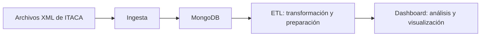

# Proyecto 1 — Analítica académica ITACA (origen XML)

## Descripción

Proyecto del módulo de Big Data Aplicado orientado al análisis de
datos académicos de ITACA cuyo origen son archivos XML.

El repositorio contiene la estructura inicial para desarrollar los
procesos de ingesta, transformación y visualización de datos, además
de la configuración de MongoDB mediante Docker Compose.

## Objetivo

Preparar un entorno de trabajo que permita incorporar datos académicos
procedentes de archivos XML, almacenarlos en MongoDB y desarrollar
posteriormente su transformación y análisis.

En esta primera fase se prepara el repositorio Git, la estructura de
carpetas y la configuración inicial del servicio de MongoDB.

## Arquitectura

El siguiente diagrama representa una propuesta inicial del flujo de
datos. Los procesos de ingesta, ETL y visualización todavía están
pendientes de implementación.



## Estructura del repositorio

```text
Proyecto1/
├── ingesta/
├── etl/
├── dashboard/
├── .gitignore
├── docker-compose.yml
└── README.md
```

- `ingesta/`: futuros procesos de lectura e incorporación de datos XML.
- `etl/`: futuros procesos de extracción, transformación y carga.
- `dashboard/`: futura visualización de los resultados.
- `.gitignore`: reglas para excluir datos, credenciales y archivos locales.
- `docker-compose.yml`: configuración del servicio de MongoDB.
- `README.md`: documentación principal del proyecto.

## Requisitos del entorno

- Git y cuenta en GitHub.
- Docker Desktop y Docker Compose.
- Python 3.10 o superior y pip.
- Editor de código, como Visual Studio Code.

## Puesta en marcha de MongoDB

Con Docker Desktop iniciado, abrir PowerShell en la carpeta `Proyecto1`
y ejecutar:

```powershell
docker compose up -d
```

Comprobar el estado del contenedor:

```powershell
docker compose ps
```

El contenedor `bigdata-mongo` debe aparecer con estado `Up`.

## Estado actual

El repositorio dispone de la estructura inicial y del archivo de
configuración de MongoDB.

La ejecución del servicio debe comprobarse mediante `docker compose ps`.
Los procesos de ingesta, ETL y dashboard están pendientes de desarrollo.